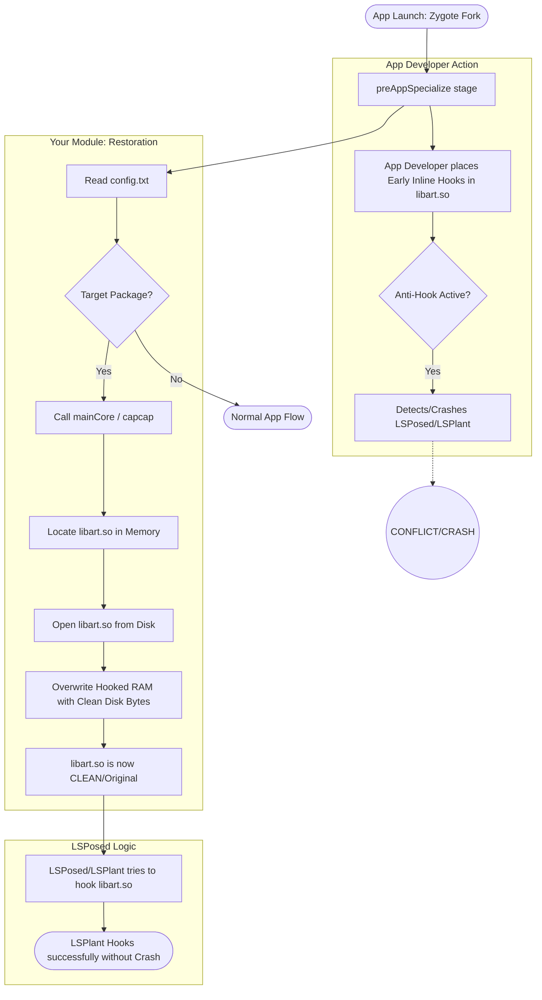

# Zygisk Invalidate Hooks

This module restores original library bytes from disk to memory to remove inline hooks inserted by App Developers to block Xposed/LSPosed.

## Why this is needed?
App developers often place early inline hooks in `libart.so` during the `preAppSpecialize` fork stage. When LSPosed which uses the **LSPlant** engine attempts to hook the same methods it conflicts with the developer's hooks

This module invalidates wipes out those early hooks by restoring clean bytes from the disk before LSPosed starts its work

## Process Flowchart

## Config Path
`/data/adb/modules/inline_hook_spoof/config.txt`

### Config Format:
`1:libart.so` (1 for enabled)  
`com.example.app` (package names line by line)

## DevicePreset settings integration

This source tree also carries DevicePreset's property-profile application mechanism. The included `template/config/device.prop` is generated from the bundled **Google Pixel 10 Pro** profile and is applied during `post-fs-data` using `/system/bin/linker64 /system/bin/resetprop-rs --stealth`. Edit `config/device.prop` in the installed module to change values; `config.txt` remains the separate original Zygisk app-target list and is not overwritten.

The property applicator skips `ro.product.hardware`, `ro.hardware`, `ro.board.platform`, and `ro.boot.board.platform` to preserve the previously established boot-safety exclusions. The resetprop-rs executable expected at `/system/bin/resetprop-rs` is ARM64-only; on other architectures the property step logs and skips without stopping module initialization. Application results, including a read-back comparison against `getprop`, are recorded in `/data/adb/modules/inline_hook_spoof/last_apply.log`. A successful command is not reported as verified unless the resulting property value matches the requested value. The original native Zygisk source and its configuration format are otherwise unchanged. The resetprop-rs executable is provided at the fixed system path and is not bundled or searched for inside the module. DevicePreset property application remains system-wide and independent from the webroot app-target list.

### Property diagnostics

Run `su -c sh /data/adb/modules/inline_hook_spoof/audit-properties.sh` to compare each configured property with its current `getprop` value. The report verifies the Android property store only; it does not claim that TelephonyManager, CPU information from sysfs/device tree, or other independent hardware interfaces expose the same values. The boot scripts also record `getprop` read-back mismatches in `last_apply.log`.

## DevicePreset native runtime hooks (step 7)

The module builds `module/src/main/cpp/native_spoof.cpp` into the Zygisk shared
library. For apps selected by the original `config.txt`, native property API
imports are hooked to read the configured `device.prop` overrides, and imported
`open`/`openat`/`fopen` calls can receive a synthesized `/proc/cpuinfo` or
`/proc/version` view from `config/proc-overrides.conf`. Hook installation occurs
in `postAppSpecialize`; the existing `mainCore.cxx` call and implementation are
left intact. This implementation patches PLT/GOT relocations, so it is not a
universal interception of direct syscalls or libraries loaded after the initial
pass. Verify behavior on-device with an app that exercises each API.
